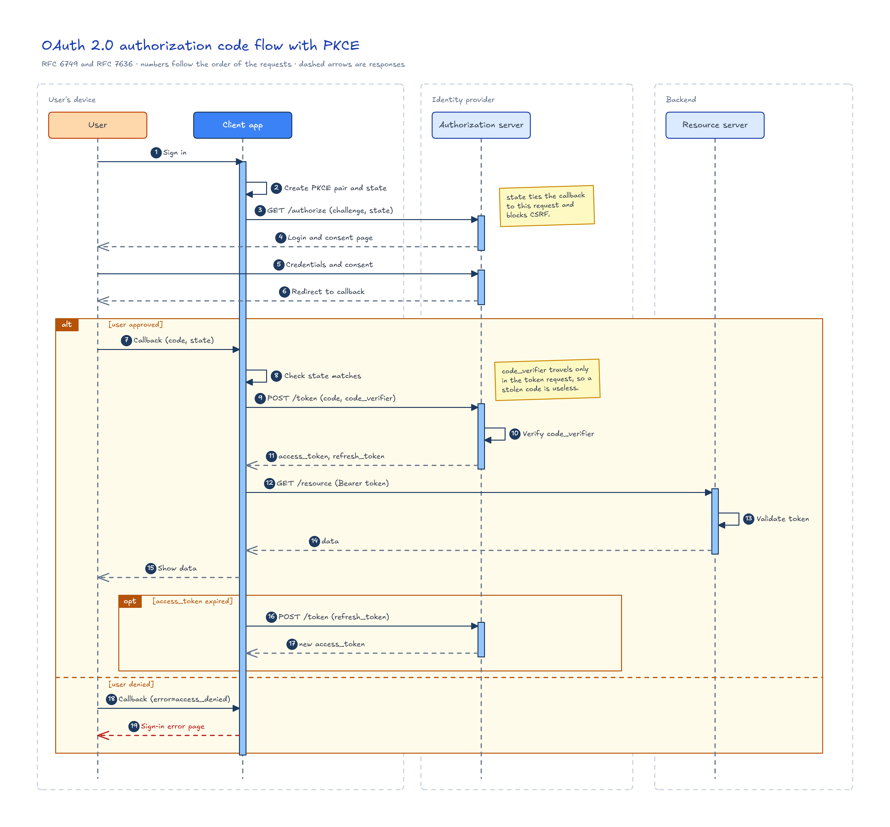
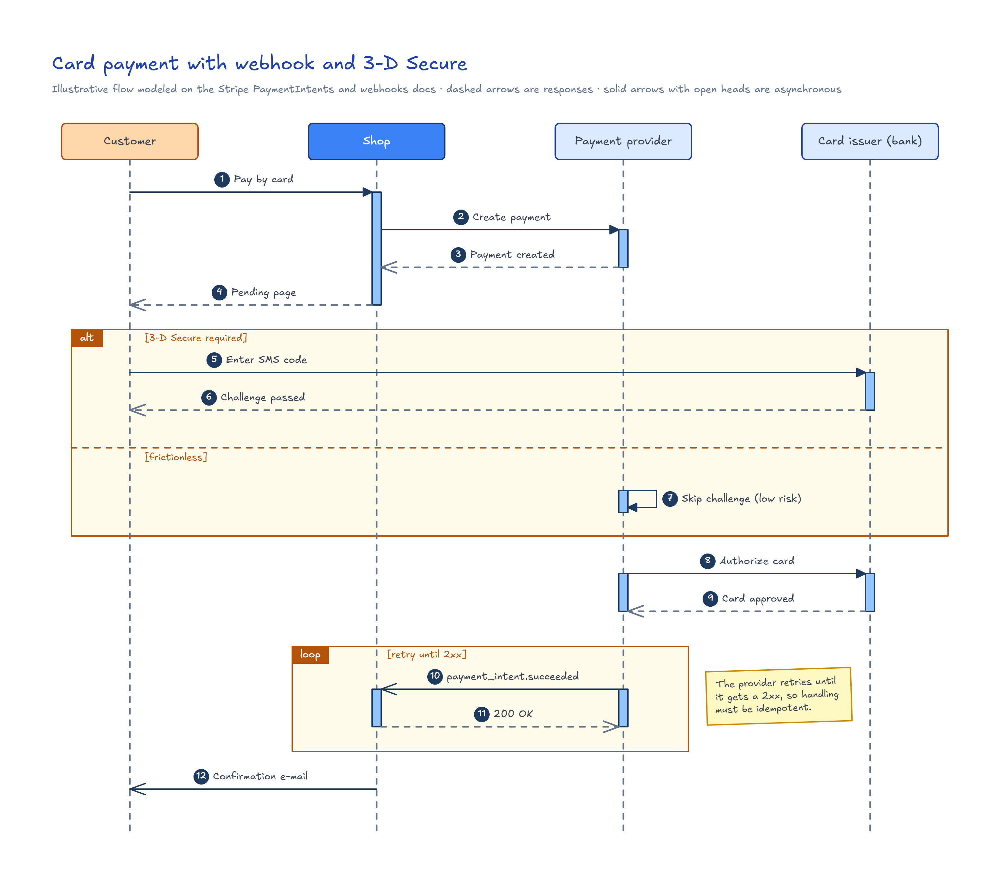
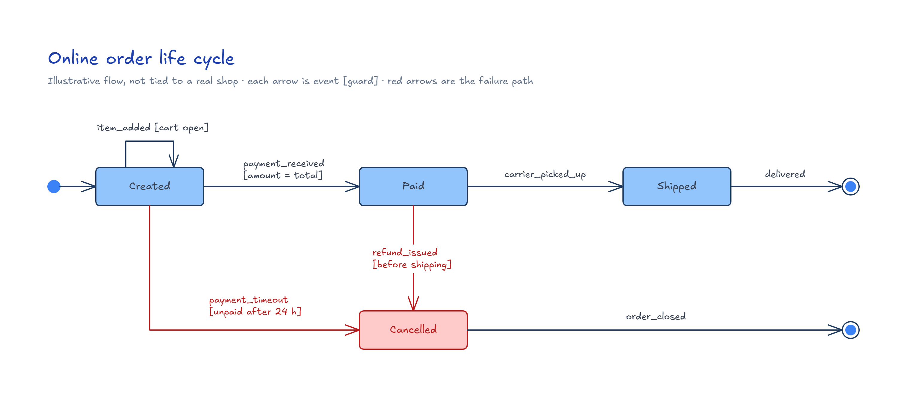
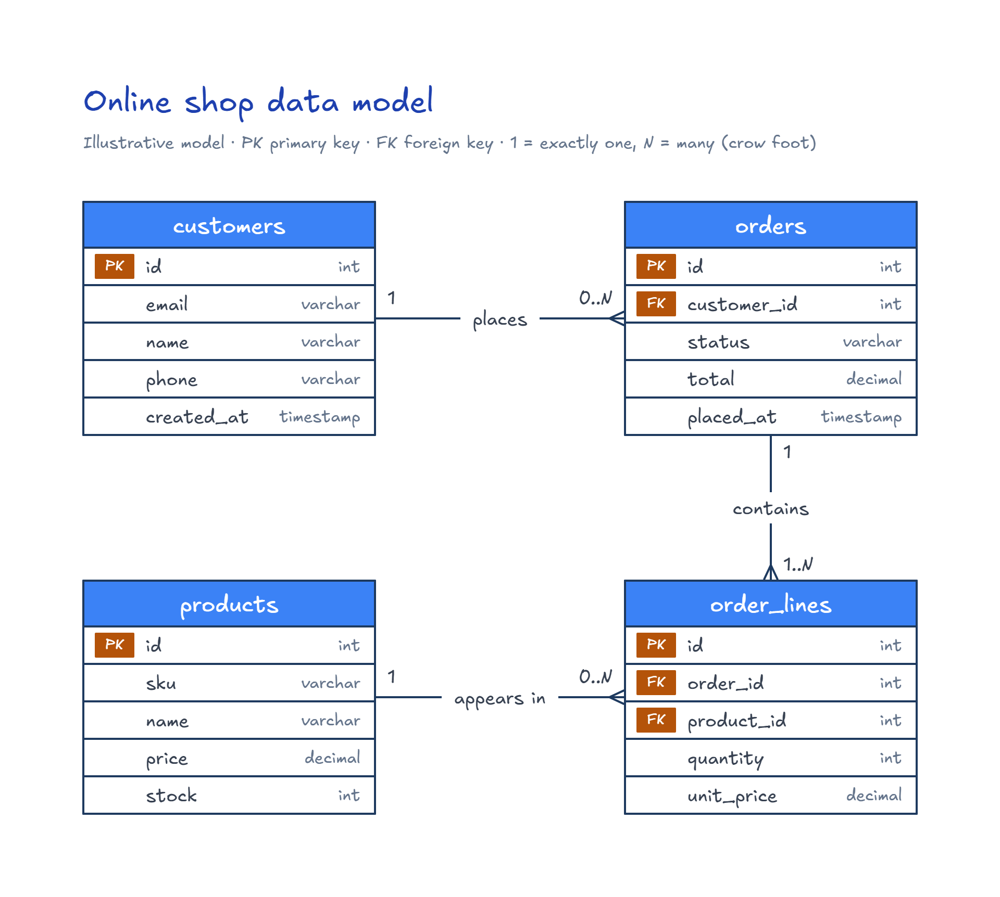
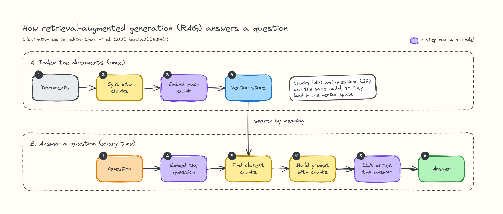
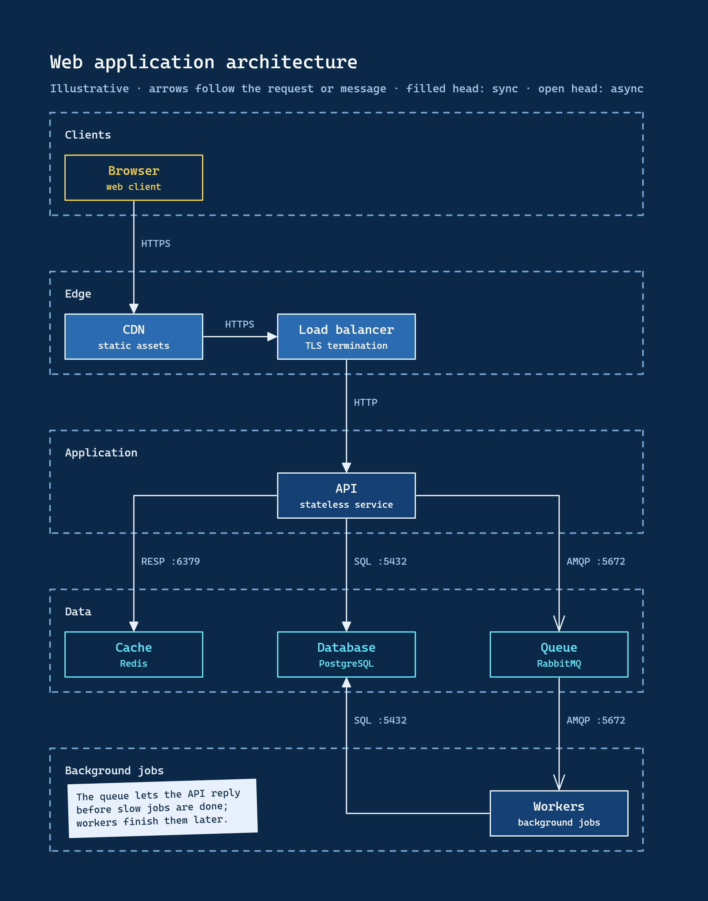

# Excalidraw Design Diagrams

Tooling for an agent skill that creates and visually validates Excalidraw diagrams (`.excalidraw` files) that explain workflows, architectures and concepts.

The baseline skill lives in [`skill/`](skill/). Its rendering tools are documented in [`skill/references/README.md`](skill/references/README.md).

## Requirements

- Node.js 22.18 or later.
- Google Chrome or Chromium, for rendering. Set `CHROME_PATH` if it is not in a default location.

## Commands

```bash
npm install # installs the renderer and the DESIGN.md parser dependencies
npm test    # runs the test suite with node:test
```

## Usage

The agent draws the `.excalidraw` file itself, following the guide for the diagram type, and the scripts do the mechanical work. In the commands below, `<skill>` is the skill directory (`skill/` in this repository), and you run them from your project root.

```bash
# 1. Apply colors, fonts and corner radius from DESIGN.md to every element, by its role
node <skill>/scripts/restyle.js diagrams/login.excalidraw

# 2. Check structure, overlapping text and padding; exits with 1 and lists each problem
node <skill>/scripts/validate.js diagrams/login.excalidraw

# 3. Render a PNG to review and an SVG for documentation, written beside the file
node <skill>/references/render_excalidraw.js diagrams/login.excalidraw
```

- The `.excalidraw` file is the source of truth; later changes are edits to it. After changing `DESIGN.md`, run the three steps again.
- Each diagram type has a guide with its layout rules and checklists; see the types table in [`skill/SKILL.md`](skill/SKILL.md).
- Render options (`--output`, `--scale`, `--width`) are listed in [`skill/references/README.md`](skill/references/README.md).
- Styles come from `DESIGN.md`. `restyle.js` and `validate.js` use the file given with `--design`, else the project's `DESIGN.md` (or `docs/DESIGN.md`) next to the diagram, and the base design in [`skill/DESIGN.md`](skill/DESIGN.md) always applies underneath, so the file only overrides the tokens it defines.
- The example gallery is below; the full index is in [`skill/examples/README.md`](skill/examples/README.md).

## Examples gallery

Each example is a folder with the `.excalidraw` file and its PNG and SVG renders.

| Screenshot | Example | Diagram type | Style |
| --- | --- | --- | --- |
| [](skill/examples/oauth-pkce/) | [oauth-pkce](skill/examples/oauth-pkce/) | Sequence | Base |
| [](skill/examples/card-payment/) | [card-payment](skill/examples/card-payment/) | Sequence | Base |
| [](skill/examples/order-lifecycle/) | [order-lifecycle](skill/examples/order-lifecycle/) | State | Base |
| [](skill/examples/online-shop-data-model/) | [online-shop-data-model](skill/examples/online-shop-data-model/) | Data model | Base |
| [](skill/examples/concept-rag/) | [concept-rag](skill/examples/concept-rag/) | Concept | Whiteboard (full restyle) |
| [](skill/examples/web-app-architecture/) | [web-app-architecture](skill/examples/web-app-architecture/) | Architecture | Blueprint (full restyle) |
| [](skill/examples/ci-cd-pipeline/) | [ci-cd-pipeline](skill/examples/ci-cd-pipeline/) | Decision flow | Corporate grey (partial: colors and font) |

### How a project style overrides the base

The base design in [`skill/DESIGN.md`](skill/DESIGN.md) always applies. A `DESIGN.md` in the example folder (or the one passed with `--design`) overrides it token by token, so it only needs to define what changes. The diagram file does not change: restyling it recolors every element through its role.

- Base style, no `DESIGN.md`: [oauth-pkce](skill/examples/oauth-pkce/), [card-payment](skill/examples/card-payment/), [order-lifecycle](skill/examples/order-lifecycle/) and [online-shop-data-model](skill/examples/online-shop-data-model/).
- Complete override, which replaces the palette, font, corner radius, roughness and canvas background (roles it does not redefine come from the base): [concept-rag](skill/examples/concept-rag/DESIGN.md) (whiteboard) and [web-app-architecture](skill/examples/web-app-architecture/DESIGN.md) (blueprint).
- Partial override, which changes only the colors and the font and inherits everything else: [ci-cd-pipeline](skill/examples/ci-cd-pipeline/DESIGN.md) (corporate grey).

## Install the skill manually

The skill is not installed automatically. To use it:

1. Run `npm install` at the repository root, the folder that contains `package.json`.
2. Put the `skill/` folder in your Claude Code skills folder (`~/.claude/skills/excalidraw-diagram`). You can link it, so a `git pull` updates it, or copy the whole repository there and point to its `skill/` folder; the scripts need the repository's `node_modules`, so copying `skill/` alone does not work.
3. Start a new Claude Code session and check that the skill is listed.

## Working rules

- Develop test-first: write a failing test, then the minimal code that passes it, one slice at a time.
- Ask before adding any new dependency, and explain why it is needed. The renderer depends on `@excalidraw/utils` and `esbuild`, pinned to exact versions.
- Use [Conventional Commits](https://www.conventionalcommits.org/) for commit messages, one logical change per commit.
- Follow GitFlow: branch `feature/*` and `bugfix/*` from `develop`, branch `hotfix/*` from `main`, and never commit directly to `main`.

Architecture decisions are recorded in [`docs/adr/`](docs/adr/).
