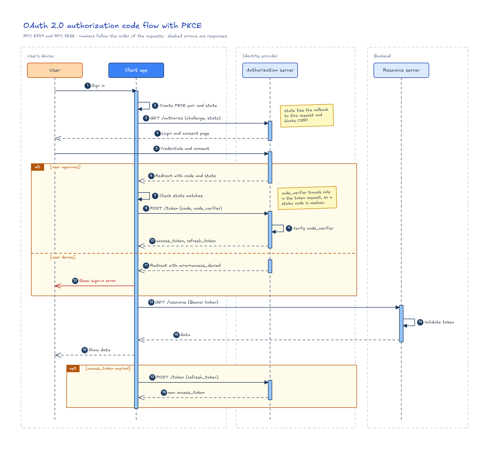
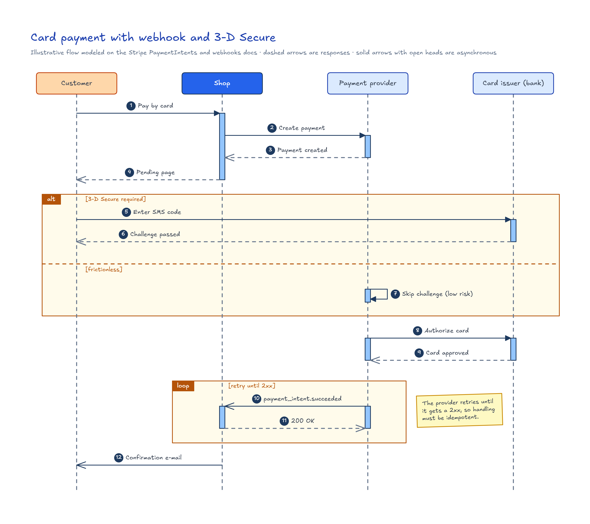
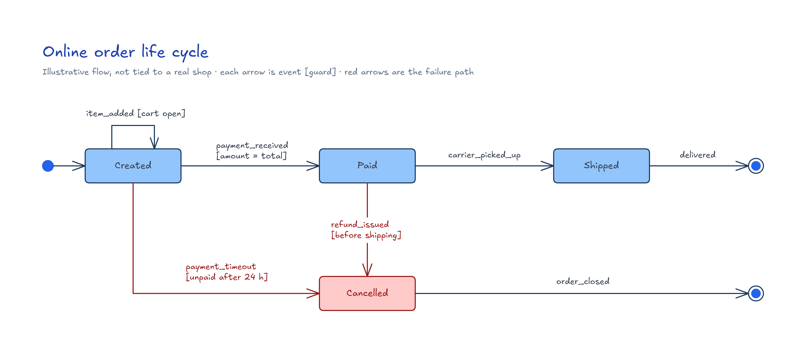
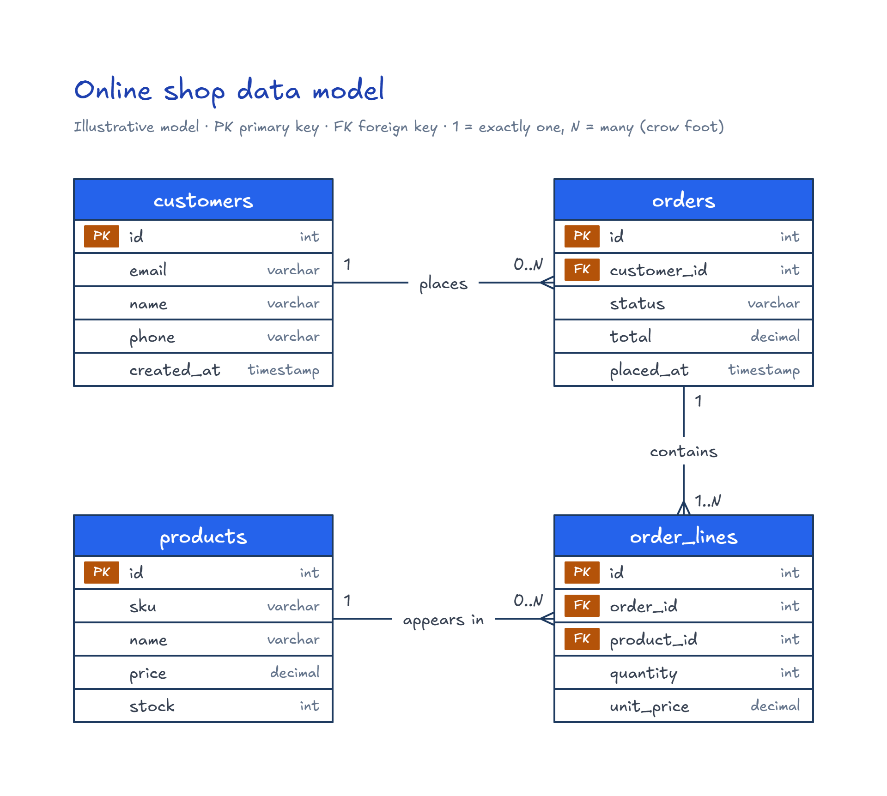
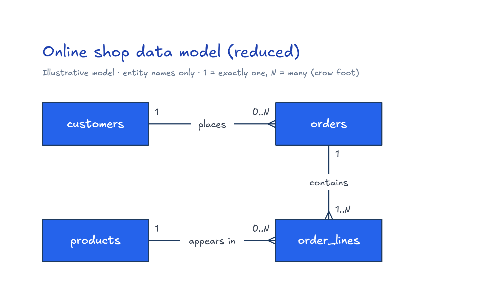
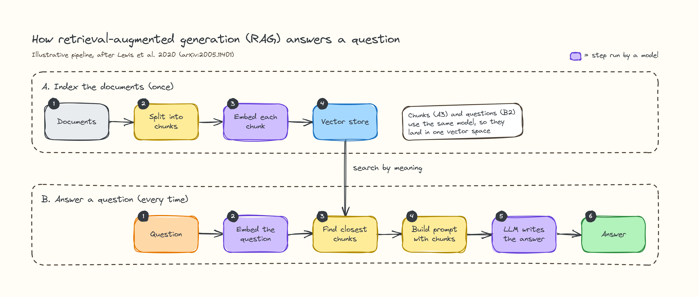
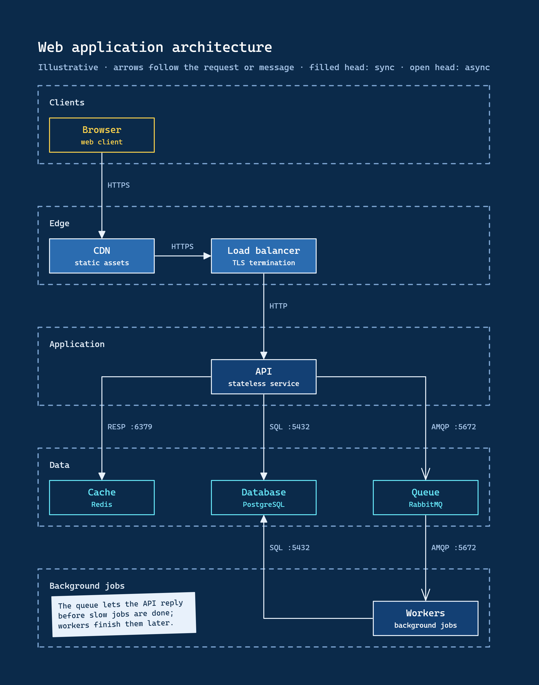
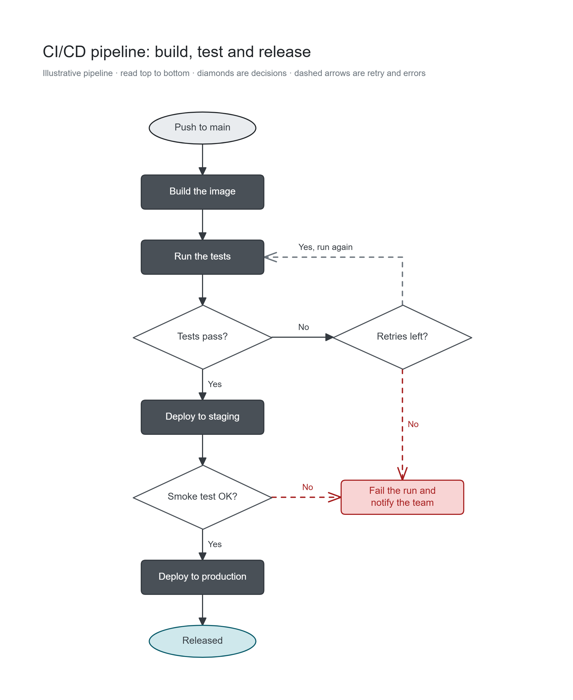
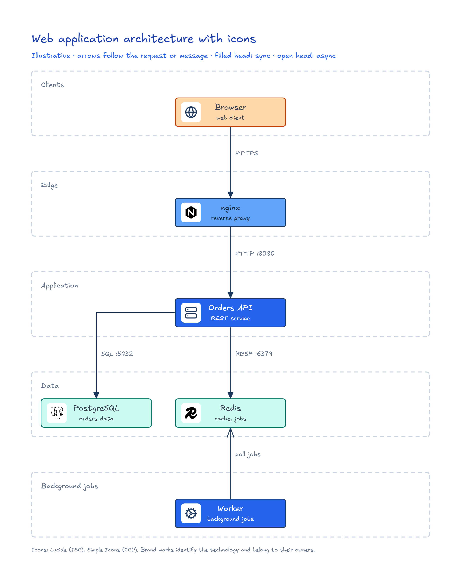

# Excalidraw Design Diagrams

Tooling for an agent skill that creates and visually validates Excalidraw diagrams (`.excalidraw` files) that explain workflows, architectures and concepts.

The baseline skill lives in [`skills/excalidraw-diagram/`](skills/excalidraw-diagram/). Its rendering tools are documented in [`skills/excalidraw-diagram/references/README.md`](skills/excalidraw-diagram/references/README.md).

## Requirements

- Node.js 22.18 or later.
- Google Chrome or Chromium, for rendering. Set `CHROME_PATH` if it is not in a default location.

## Commands

```bash
npm install # installs the skill dependencies (a workspace) for development
npm test    # runs the test suite with node:test
```

## Usage

The agent draws the `.excalidraw` file itself, following the guide for the diagram type, and the scripts do the mechanical work. In the commands below, `<skill>` is the skill directory (`skills/excalidraw-diagram/` in this repository), and you run them from your project root.

```bash
# 1. Apply colors, fonts and corner radius from DESIGN.md to every element, by its role
node <skill>/scripts/restyle.js diagrams/login.excalidraw

# 2. Check structure, overlapping text and padding; exits with 1 and lists each problem
node <skill>/scripts/validate.js diagrams/login.excalidraw

# 3. Render a PNG to review and an SVG for documentation, written beside the file
node <skill>/references/render_excalidraw.js diagrams/login.excalidraw
```

- The `.excalidraw` file is the source of truth; later changes are edits to it. After changing `DESIGN.md`, run the three steps again.
- Each diagram type has a guide with its layout rules and checklists; see the types table in [`skills/excalidraw-diagram/SKILL.md`](skills/excalidraw-diagram/SKILL.md).
- Render options (`--output`, `--scale`, `--width`) are listed in [`skills/excalidraw-diagram/references/README.md`](skills/excalidraw-diagram/references/README.md).
- Styles come from `DESIGN.md`. `restyle.js` and `validate.js` use the file given with `--design`, else the project's `DESIGN.md` (or `docs/DESIGN.md`) next to the diagram, and the base design in [`skills/excalidraw-diagram/DESIGN.md`](skills/excalidraw-diagram/DESIGN.md) always applies underneath, so the file only overrides the tokens it defines.
- The example gallery is below; the full index is in [`examples/README.md`](examples/README.md).

## Examples gallery

Each example is a folder with the `.excalidraw` file and its PNG and SVG renders.

| Screenshot                                                                                                                 | Example                                                    | Diagram type            | Style                                     |
| -------------------------------------------------------------------------------------------------------------------------- | ---------------------------------------------------------- | ----------------------- | ----------------------------------------- |
| [](examples/oauth-pkce/)                                         | [oauth-pkce](examples/oauth-pkce/)                         | Sequence                | Base                                      |
| [](examples/card-payment/)              | [card-payment](examples/card-payment/)                     | Sequence                | Base                                      |
| [](examples/order-lifecycle/)                      | [order-lifecycle](examples/order-lifecycle/)               | State                   | Base                                      |
| [](examples/online-shop-data-model/)  | [online-shop-data-model](examples/online-shop-data-model/) | Data model              | Base                                      |
| [](examples/online-shop-reduced/) | [online-shop-reduced](examples/online-shop-reduced/)       | Data model              | Base                                      |
| [](examples/concept-rag/)                                      | [concept-rag](examples/concept-rag/)                       | Concept                 | Whiteboard (full restyle)                 |
| [](examples/web-app-architecture/)  | [web-app-architecture](examples/web-app-architecture/)     | Architecture            | Blueprint (full restyle)                  |
| [](examples/ci-cd-pipeline/)                                  | [ci-cd-pipeline](examples/ci-cd-pipeline/)                 | Decision flow           | Corporate grey (partial: colors and font) |
| [](examples/web-app-icons/)            | [web-app-icons](examples/web-app-icons/)                   | Architecture with icons | Base                                      |

### How a project style overrides the base

The base design in [`skills/excalidraw-diagram/DESIGN.md`](skills/excalidraw-diagram/DESIGN.md) always applies. A `DESIGN.md` in the example folder (or the one passed with `--design`) overrides it token by token, so it only needs to define what changes. The diagram file does not change: restyling it recolors every element through its role.

- Base style, no `DESIGN.md`: [oauth-pkce](examples/oauth-pkce/), [card-payment](examples/card-payment/), [order-lifecycle](examples/order-lifecycle/), [online-shop-data-model](examples/online-shop-data-model/) and [online-shop-reduced](examples/online-shop-reduced/) and [web-app-icons](examples/web-app-icons/).
- Complete override, which replaces the palette, font, corner radius, roughness and canvas background (roles it does not redefine come from the base): [concept-rag](examples/concept-rag/DESIGN.md) (whiteboard) and [web-app-architecture](examples/web-app-architecture/DESIGN.md) (blueprint).
- Partial override, which changes only the colors and the font and inherits everything else: [ci-cd-pipeline](examples/ci-cd-pipeline/DESIGN.md) (corporate grey).

## Install the skill

Install it with the [`skills`](https://github.com/vercel-labs/skills) CLI. Run it in your project to install the skill there, or add `-g` to make it available in every project:

```bash
npx skills add alexmarco/excalidraw-design-diagrams --skill excalidraw-diagram -a claude-code
npx skills add alexmarco/excalidraw-design-diagrams --skill excalidraw-diagram -a claude-code -g
```

On Windows, add `--copy` if creating symlinks is not allowed. The CLI copies only the `skills/excalidraw-diagram/` folder, to `.claude/skills/excalidraw-diagram/` in the project (or `~/.claude/skills/excalidraw-diagram/` with `-g`).

First run: install the skill's dependencies once, in the installed folder.

```bash
cd .claude/skills/excalidraw-diagram
npm install --omit=dev
```

If you skip it, the scripts print this command with the exact folder. To update, run `npx skills update`, then `npm install --omit=dev` again if `package.json` changed.

## Install the skill manually

Copy the `skills/excalidraw-diagram/` folder to `.claude/skills/excalidraw-diagram/` in your project (or `~/.claude/skills/excalidraw-diagram` for every project), run `npm install --omit=dev` inside the copy, and start a new Claude Code session to check that the skill is listed.

## Development workflow

GitHub Actions runs `npm ci` and `npm test` for pull requests targeting `main` or `develop`, and for pushes to those branches. Branch protection must require the `test` job before merging.

When changing a diagram guide, have an agent draw a diagram using that guide and review it against the guide's communication and visual checklists. Include the diagram or the validation evidence with the change so reviewers can verify the guide in practice.

## Working rules

- Develop test-first: write a failing test, then the minimal code that passes it, one slice at a time.
- Ask before adding any new dependency, and explain why it is needed. The renderer depends on `@excalidraw/utils` and `esbuild`, pinned to exact versions.
- Use [Conventional Commits](https://www.conventionalcommits.org/) for commit messages, one logical change per commit.
- Follow GitFlow: branch `feature/*` and `bugfix/*` from `develop`, branch `hotfix/*` from `main`, and never commit directly to `main`.

Architecture decisions are recorded in [`docs/adr/`](docs/adr/).
